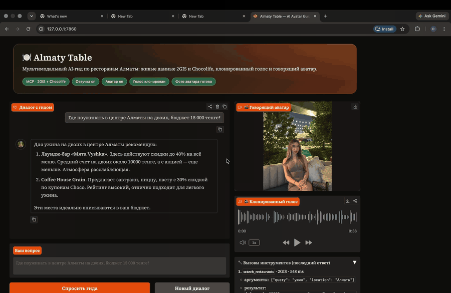
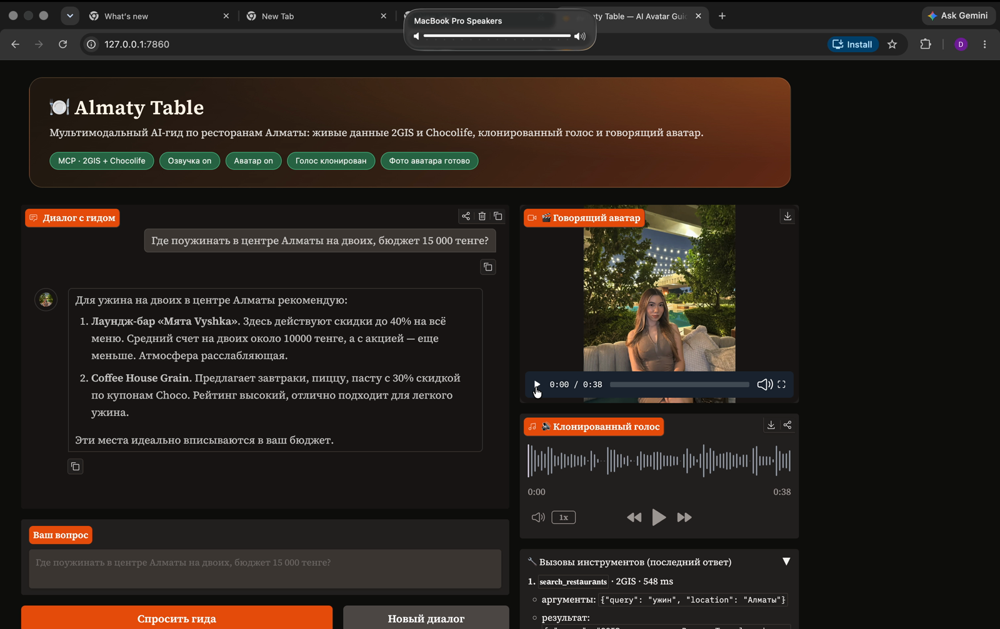
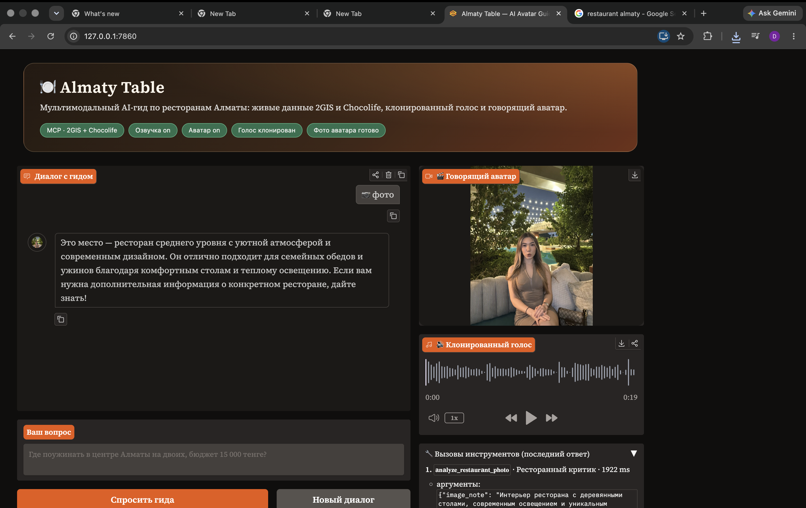
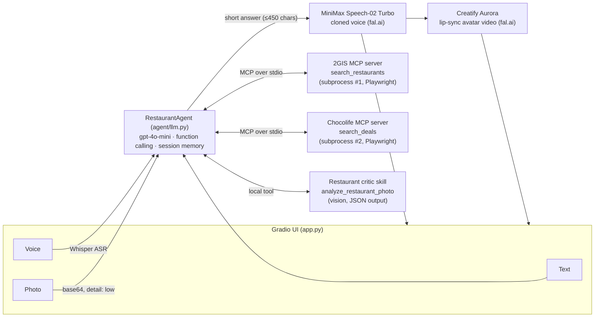
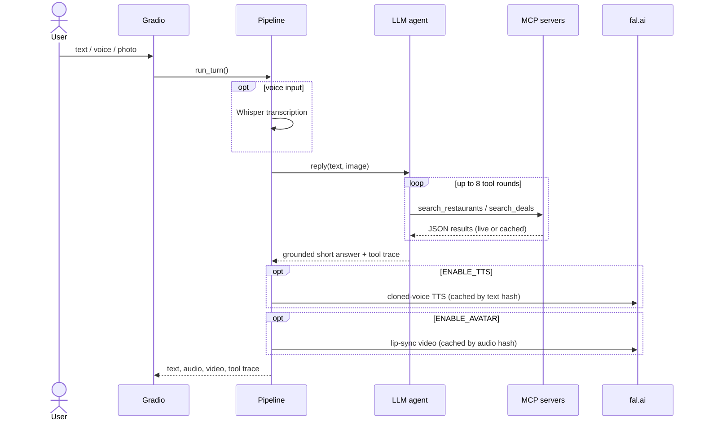

# 🍽 Almaty Table — Multimodal AI Avatar Agent

**An AI restaurant guide for Almaty that you can talk to by text, voice, or photo. It finds live data through its own MCP servers and replies as a talking video avatar in a cloned voice.**


<p align="center">
  
</p>

> 🎬 Full-quality demo: [`docs/media/app_demo.mp4`](docs/media/app_demo.mp4) · Avatar answer samples: [short](docs/media/avatar_answer_short.mp4), [long](docs/media/avatar_answer_long.mp4)

---

## Table of contents

- [What it does](#what-it-does)
- [Key highlights](#key-highlights)
- [Architecture](#architecture)
- [How a single turn works](#how-a-single-turn-works)
- [Tech stack and model choices](#tech-stack-and-model-choices)
- [Engineering decisions](#engineering-decisions)
- [Project structure](#project-structure)
- [Getting started](#getting-started)
- [Configuration](#configuration)
- [Cost control](#cost-control)
- [Limitations and future work](#limitations-and-future-work)
- [Русская версия](#русская-версия)

---

## What it does

Ask *"Where can two people have dinner in central Almaty on a 15,000 tenge budget?"*, by typing, speaking, or uploading a photo of a place you liked. The agent will:

1. **Understand the input.** Speech is transcribed with Whisper, and photos are analyzed with a vision model.
2. **Decide which tools to call.** The LLM uses function calling to query two custom **MCP servers** that scrape live data from [2GIS](https://2gis.kz) (restaurant listings, ratings, addresses, hours) and [Chocolife](https://chocolife.me) (current discounts and coupons).
3. **Use a "restaurant critic" skill on photos.** It classifies a venue's price level, vibe, and target audience from a photo, then uses that to recommend similar places.
4. **Answer in about 20 seconds of speech.** The text answer is spoken in **my own cloned voice** (MiniMax), then turned into a **lip-synced talking-head video** of me (Creatify Aurora).
5. **Show its work.** The UI displays every tool call with its arguments, result preview, and latency, plus the live health of each MCP server.

The interface and answers are in Russian, matching the local audience.

| Text → recommendations with live deals | Photo → restaurant-critic analysis |
|---|---|
|  |  |

## Key highlights

- **Real MCP architecture, not wrapped functions.** Each data source is a standalone MCP server running as its **own stdio subprocess**. Tools are discovered at runtime via `list_tools()` and converted into OpenAI function schemas automatically, so adding a new server takes no changes to the agent code.
- **Full multimodal loop.** Voice, text, and image go in; text, cloned speech, and avatar video come out, all in one pipeline.
- **Autonomous tool use.** The LLM chooses which tools to call, can run several rounds (up to 8), and grounds its answers in tool results instead of guessing addresses or prices.
- **Resilient scraping.** The servers capture 2GIS's internal catalog API responses, fall back to DOM parsing, detect captchas, and serve **stale cached data** when a site is down.
- **Cost-aware by design.** Caching is applied at every paid step (scrapes, TTS, video, photo upload). Paid features are behind feature flags, and answers are length-capped so the expensive steps stay short. The whole project fit in a **~$15–20 budget**.
- **Graceful degradation.** If one MCP server crashes, the others keep working. If TTS or the avatar fails, the user still gets the text answer and a readable error.

## Architecture



`MCPHub` (`agent/mcp_hub.py`) starts each server with `sys.executable`, so the subprocess always uses the same virtualenv. Each server's lifetime is held inside its own long-running asyncio task, because `anyio` requires the stdio client context to be entered and exited in the same task.

## How a single turn works



## Tech stack and model choices

| Component | Technology | Why this choice |
|---|---|---|
| Speech-to-text | OpenAI Whisper (`whisper-1`) | Reliable Russian transcription with no local GPU needed |
| LLM + vision | `gpt-4o-mini` | Cheap, fast function calling and vision in a single model |
| Tool protocol | Model Context Protocol (`mcp` SDK, stdio transport) | Standard, swappable tool servers isolated in their own processes |
| Data collection | Playwright (headless Chromium) | Both sites render with JavaScript; capturing network responses gives structured data |
| Voice cloning | MiniMax Voice Clone via fal.ai | Clones a voice from about 10 seconds of audio for roughly $0.50, one time |
| Text-to-speech | MiniMax Speech-02 Turbo via fal.ai | About 1.7× cheaper than the HD model, with good enough quality |
| Talking avatar | Creatify Aurora via fal.ai | Studio-quality lip sync from a single portrait photo |
| UI | Gradio Blocks with a custom theme and CSS | Fast multimodal UI: microphone, image upload, audio and video players |

## Engineering decisions

**Tool discovery instead of hard-coding.** `MCPHub._refresh_tools()` reads each server's tool list and input schema at startup and translates them into OpenAI `tools` definitions. The agent also tracks which server owns each tool, so the UI trace can show where every result came from.

**Conversation memory that never breaks the API.** An assistant message with `tool_calls` and the `tool` messages that answer it must stay together; splitting them causes OpenAI 400 errors. `RestaurantAgent._trim()` always cuts history at a **user** message boundary, so tool-call groups stay intact while memory stays bounded (`SESSION_HISTORY_LIMIT = 12`).

**Answers sized for speech.** The system prompt asks for 80–90 words, and `_limit_reply()` enforces a 450-character cap, cutting at a sentence boundary. This keeps the TTS and avatar video at about 15–30 seconds, which controls both latency and cost.

**Scraping that degrades gracefully.**
- *2GIS:* listens for `catalog.api.2gis` JSON responses for clean structured data, falls back to parsing the page if none arrive, and detects captcha pages and raises an error instead of caching a useless result.
- *Chocolife:* collects deal links, falls back to generic card selectors, and extracts original price, discounted price, and discount percentage with regular expressions.
- *Both:* use a 10-minute file cache, and if the live site fails, return the last good (stale) cache. Stale data is better than no data.

**Isolated failure domains.** A crashed or timed-out MCP server only marks itself `error` in the status panel. Tool calls have a 120-second timeout, and TTS and avatar errors are shown to the user without losing the text answer.

**Thread-safe async bridge.** Gradio callbacks are synchronous, while MCP sessions are async. A single background event loop owns all MCP sessions, and callbacks submit work to it with `run_coroutine_threadsafe`, so sessions are never used from the wrong loop.

## Project structure

```
.
├── app.py                     # Gradio UI, async bridge, tool-trace and status panels
├── config.py                  # Environment config, feature flags, paths, limits
├── agent/
│   ├── llm.py                 # RestaurantAgent: system prompt, tool loop, memory trimming
│   ├── mcp_hub.py             # Starts MCP servers as subprocesses, discovers and routes tools
│   ├── pipeline.py            # One turn: ASR → LLM → TTS → avatar
│   └── tools.py               # "Restaurant critic" vision skill (JSON output)
├── mcp_servers/
│   ├── twogis/server.py       # MCP server: search_restaurants (2GIS)
│   └── chocolife/server.py    # MCP server: search_deals (Chocolife)
├── voice/
│   ├── clone.py               # One-time voice cloning → voice_id.txt
│   └── tts.py                 # Cloned-voice TTS with a content-hash cache
├── avatar/
│   └── generate.py            # Lip-sync avatar video with a content-hash cache
├── docs/media/                # Demo GIF, demo video, screenshots, sample avatar answers
├── requirements.txt
└── .env.example
```

## Getting started

### Prerequisites

- Python 3.12
- An [OpenAI API key](https://platform.openai.com) (LLM, vision, Whisper)
- A [fal.ai API key](https://fal.ai) (voice clone, TTS, avatar). Only needed for voice and video output.

### 1. Install

```bash
git clone https://github.com/<your-username>/almaty-table-ai-avatar.git
cd almaty-table-ai-avatar

python3 -m venv venv
source venv/bin/activate
pip install -r requirements.txt
playwright install chromium
```

### 2. Configure

```bash
cp .env.example .env
# then fill in OPENAI_API_KEY (and FAL_KEY for voice/video)
```

### 3. Run in text-only mode first (cheapest)

```bash
python app.py
```

Open http://127.0.0.1:7860 and try one of the built-in examples. The **Tool calls** panel shows which MCP tools the LLM chose and how long each took.

You can also start each MCP server on its own to debug it:

```bash
python mcp_servers/twogis/server.py
python mcp_servers/chocolife/server.py
```

### 4. Turn on voice and avatar

1. Record at least 10 seconds of clean speech to `voice/my_voice_sample.wav`, then run `python voice/clone.py`. This saves a voice ID to `voice_id.txt`.
2. Add a front-facing portrait at `avatar/my_photo.jpg`.
3. Set `ENABLE_TTS=true`, restart, and check the voice. Then set `ENABLE_AVATAR=true`.

> ⚠️ 2GIS may show a captcha to data-center IP addresses. Run from a home or mobile connection. If it does, the server returns its last cached results.

## Configuration

| Variable | Default | Description |
|---|---|---|
| `OPENAI_API_KEY` | — | Required. Used for the LLM, vision, and Whisper |
| `OPENAI_MODEL` | `gpt-4o-mini` | Chat and tool-calling model |
| `OPENAI_VISION_MODEL` | `gpt-4o-mini` | Model for the restaurant-critic skill |
| `FAL_KEY` | — | fal.ai key in `uuid:secret` format |
| `MINIMAX_VOICE_ID` | read from `voice_id.txt` | ID of the cloned voice |
| `ENABLE_TTS` | `false` | Speak answers in the cloned voice (paid) |
| `ENABLE_AVATAR` | `false` | Generate a lip-sync video (paid, the most expensive step) |
| `AVATAR_PHOTO_URL` / `VOICE_SAMPLE_URL` | empty | Optional already-hosted URLs, to skip uploads |

## Cost control

| Technique | Where | Effect |
|---|---|---|
| `detail: "low"` image inputs | `agent/llm.py`, `agent/tools.py` | Image tokens cost a fraction of high-detail mode |
| 10-minute scrape cache with stale fallback | `mcp_servers/*/server.py` | Repeated questions don't re-run the browser |
| TTS cache keyed by hash of voice + text | `voice/tts.py` | Repeated answers are spoken for free |
| Video cache keyed by hash of the audio | `avatar/generate.py` | The same audio is never rendered twice |
| Portrait uploaded once per process | `avatar/generate.py` | No repeated uploads |
| 450-character answer cap | `agent/llm.py`, `config.py` | Short audio means a short, cheap video |
| `ENABLE_TTS` / `ENABLE_AVATAR` flags | `config.py` | Build and debug the logic without paying for media |

| Item | Approximate cost |
|---|---|
| LLM and MCP debugging (gpt-4o-mini) | < $1 |
| One-time voice clone | ~$0.50 |
| TTS for short answers | a few cents |
| Avatar video (final runs only) | the main expense |

## Limitations and future work

- **Scraper fragility.** 2GIS and Chocolife can change their page layouts. Official APIs or more robust selectors would make the scrapers sturdier.
- **Model routing.** Use a small model for the tool loop and a stronger one for the final answer.
- **Streaming.** Stream text tokens to the UI and show progress while the video renders.
- **Another MCP server.** Add a server for restaurant group menus, average bills, and table booking.
- **Tests and evaluation.** Add contract tests for MCP tool schemas and an evaluation set for recommendation quality.

---

## Русская версия

**Almaty Table** — мультимодальный AI-гид по ресторанам Алматы. Принимает текст, голос и фото, ищет живые данные через собственные MCP-серверы (2GIS и Chocolife), отвечает текстом, клонированным голосом и видео с говорящим аватаром.

- Каждый MCP-сервер — отдельный stdio-процесс; инструменты обнаруживаются автоматически и передаются LLM через function calling.
- Кастомный навык «ресторанный критик» оценивает уровень, формат и атмосферу заведения по фото.
- Кэш на каждом платном шаге, флаги `ENABLE_TTS` / `ENABLE_AVATAR`, ограничение длины ответа — проект уложился в бюджет ~$15–20.

Быстрый старт: `pip install -r requirements.txt && playwright install chromium`, скопировать `.env.example` в `.env`, запустить `python app.py`.

## License

[MIT](LICENSE) © 2026 Danagul Azimzhanova
